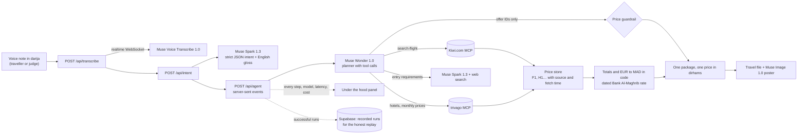

# BonSafar

A travel agency in your pocket, that understands Moroccan darija.
"Bon" (French) + "safar" (travel, in darija): the way Moroccans say "trik slama", have a safe trip.
Meta Global AI Developer Hackathon · Indie track · Theme: Build for Your World

**Live demo:** https://bonsafar.com (no login needed)
**Judges: use the private demo link given in the submission form.** It opens the 60-second judges' board with the live "Under the hood" panel.

## The problem

In 2025, Moroccans filed 619,827 Schengen visa applications and 19.2% were refused (European Commission data, released May 28, 2026). Visas, payment cards, baggage rules: one mistake costs money and months. So many people who can afford to travel still go through an agency. And they don't talk to it in English: they talk in darija, a language most voice and travel tools don't officially support.

## What BonSafar does

1. You send a voice note in darija, French or Arabic.
2. BonSafar shows what it understood, and asks at most one question.
3. An agent searches live flights and hotels and builds one package, with one price in dirhams.
4. It checks what you need before you go: visa, passport, baggage, money.
5. You pay on the partner's site, and keep a travel file and a poster.

## Architecture



## Built with Meta models

Every piece of intelligence runs on Meta models through the Meta Model API. Model IDs come from environment variables.

| Model | Used for | Why this one | Alternative considered |
|---|---|---|---|
| Muse Voice Transcribe 1.0 | The voice note, over the realtime API, biased toward Arabic and French | Streams words while you listen, and costs $0.18 per audio hour, so a 15-second note is a fraction of a cent | Muse Spark with audio input: kept only as a fallback if the realtime WebSocket fails, since audio understanding is flagged as not fully supported |
| Muse Spark 1.3 | The trip intent as strict JSON, the English translation, entry requirements with web search, and "Good to know" | Fast enough for the under-5-second "what I understood" screen, JSON schema output, and a built-in web search tool to read official visa sites | Muse Wonder for the intent: better reasoning, but slower and about 4 times the price for a task that is mostly extraction |
| Muse Wonder 1.0 | Planning the search and choosing the package with tool calls (flights, hotels, price trends, entry check), returning offer IDs only | The strongest at multi-step tool calling and at weighing trade-offs across dozens of offers: direct or cheaper, visa or visa-free alternative | Muse Spark with the same tools: cheaper, and the routing option for simple trips (see Cost), but less suited to weighing many offers at once |
| Muse Image 1.0 | Text-free illustrations of the destination ideas and the travel poster | The Meta image model, $0.01 per image, no text in the picture so nothing can be misspelled or mispriced | Hand-made or stock illustrations: ruled out, nothing in the app is taken from the web |

## Cost

A complete search (voice note, intent, agent, entry check, package) costs about **$0.07**, measured on real runs and shown call by call in the judges' panel. Ways to divide it by two:

- **Cache** MCP results and entry checks per destination and date for a few hours: the web-search entry check is one of the largest single calls.
- **Cached input tokens**: keep the long system prompts as a stable prefix. Cached input is billed $0.20 instead of $4.00 per million tokens on Muse Wonder, and $0.15 instead of $1.25 on Muse Spark.
- **Routing between Spark and Wonder**: send simple single-destination, visa-free trips to Muse Spark with tools, and keep Muse Wonder for real trade-offs (visa alternatives, budget squeezes).

A spend cap (`SPEND_LIMIT_USD`) switches live searches off for everyone when it is reached, and each IP gets a limited number of live searches per hour (10 for travellers, 30 for the judges). IPs are stored only as a salted hash.

## Live data and the price guardrail

- **No price ever comes from a model.** Flights come from the official Kiwi.com MCP server, hotels and monthly price trends from the official trivago MCP server.
- Every offer goes into a server-side price store with a short ID (F1, H1…), its source and its fetch time. The models only handle these IDs; any amount of money in model output is rejected or scrubbed, and each check is logged as a "price guardrail" event.
- Totals, differences and the euro to dirham conversion are computed by code with the Bank Al-Maghrib reference rate, and the rate date is shown next to the price.

## Under the hood and the honest replay

Every step is logged with its model or tool, latency and measured cost, and shown live in the judges' panel. If a live run on the judges' board fails, is refused, loses its connection or stays silent for 15 seconds, the board switches to a real recorded run of the same scenario. A replay is always labelled "replay", shows when its prices were captured, marks each event as replayed, and gives the time and cost measured during the recorded live run. Never a fake live result.

The judges' board is hidden from regular visitors: it opens once with a private key (not in this repository), which sets a signed, httpOnly cookie for seven days.

## External services

- Kiwi.com MCP server (flights)
- trivago MCP server (hotels and monthly price trends), and trivago hotel photos
- Natural Earth basemap (public domain) for the route map
- Supabase (auth, database, poster storage)
- Vercel (hosting)

No non-Meta AI model is used at runtime. Code was written with AI coding assistants (Cursor with Claude and Grok).

## Privacy

- **No audio is ever stored.** The voice note is transcribed, then dropped; only the transcript is kept.
- **Progressive profile:** BonSafar asks only what it needs to plan a trip it can actually book (home airport, who travels, papers held), works without an account, and keeps the profile in the browser until you sign in.
- **Export and deletion:** you can ask for an export or the deletion of your data (see the privacy page); deleting an account removes its profile and trips from the database.
- No payment data ever reaches BonSafar: you pay on the partner's site.
- The voice notes of the demo were recorded by two people close to the project, with their written consent.

## Run locally

Requirements: Node.js 20.9 or later, npm, a Supabase project and a Meta Model API key.

```bash
npm install
cp .env.example .env.local   # then fill in the values
npm run dev
```

Run `supabase/schema.sql` once in the Supabase SQL editor (tables, row-level security, the usage counters and the poster bucket).

Environment variables (see `.env.example`):

| Variable | Purpose |
|---|---|
| `META_API_KEY` | Meta Model API key (server only) |
| `META_API_BASE_URL` | Meta Model API base URL |
| `MODEL_TRANSCRIBE` | Muse Voice Transcribe model ID |
| `MODEL_SPARK` | Muse Spark model ID |
| `MODEL_SPARK_AUDIO` | Model ID of the transcription fallback |
| `MODEL_WONDER` | Muse Wonder model ID |
| `MODEL_IMAGE` | Muse Image model ID |
| `NEXT_PUBLIC_SUPABASE_URL` | Supabase project URL |
| `NEXT_PUBLIC_SUPABASE_PUBLISHABLE_KEY` | Supabase publishable key (browser) |
| `SUPABASE_SECRET_KEY` | Supabase secret key (server only) |
| `KIWI_MCP_URL` | Official Kiwi.com MCP server |
| `TRIVAGO_MCP_URL` | Official trivago MCP server |
| `EUR_MAD_RATE` | Bank Al-Maghrib EUR to MAD reference rate |
| `EUR_MAD_DATE` | Date of that rate |
| `DOTATION_MAD` | Yearly travel allowance used in "Before you go" |
| `SPEND_LIMIT_USD` | Spend cap for live searches |
| `NEXT_PUBLIC_SITE_URL` | Public site origin |
| `POSTERS_BUCKET_READY` | Set to 1 once the poster bucket exists |
| `JURY_ACCESS_KEY` | Key of the hidden judges' board |
| `JURY_SILENCE_MS` | Silence before a judges' live run switches to its replay |
| `IP_HASH_SALT` | Salt for the hashed IP of the live-search limit |
| `NEXT_PUBLIC_DEMO_VIDEO_URL` | Link to the demo video |

```bash
npm run lint
npm run build
npm run record:jury   # records the three judges' scenarios live from public/jury/*.wav
```

## Built during the event

Built during the Meta Global AI Developer Hackathon. Everything in this repository was built from scratch during the event (Oct 27 to Nov 4, 2026).

## Team

Soufiane Omari (solo)

## Licence

MIT, see [LICENSE](./LICENSE).
